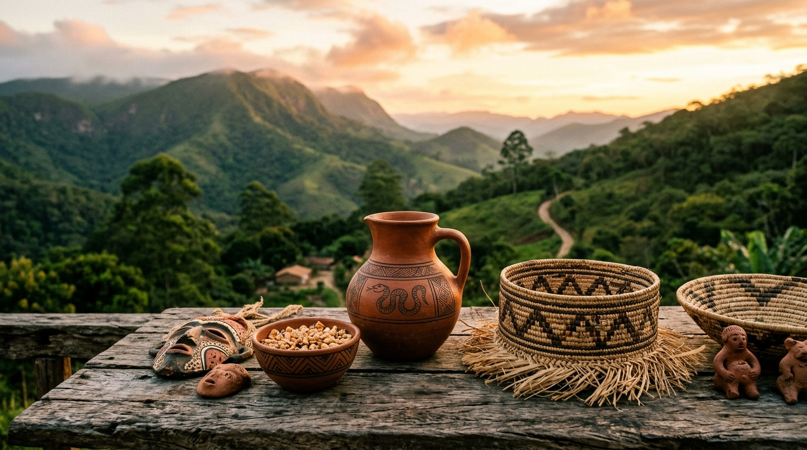

<div align="center">

# 🌿 Arte Xukuru do Ororubá

### Loja Virtual de Artesanato Indígena Autêntico

[](https://developer.mozilla.org/pt-BR/docs/Web/HTML)
[](https://developer.mozilla.org/pt-BR/docs/Web/CSS)
[](https://developer.mozilla.org/pt-BR/docs/Web/JavaScript)
[](LICENSE)

<br/>

> *"Cada peça é um ato político de resistência e um investimento direto na vida e na dignidade das famílias Xukuru."*

<br/>



</div>

---

## 📖 Sobre o Projeto

**Arte Xukuru do Ororubá** é uma plataforma de e-commerce com propósito social, desenvolvida para conectar os artesãos do **povo Xukuru do Ororubá** — o maior povo indígena de Pernambuco — diretamente ao mercado nacional.

Cada transação realizada na plataforma distribui **80% do valor pago diretamente à família artesã**, financiando saúde, educação e preservação cultural nas 27 aldeias da Serra do Ororubá, em Pesqueira (PE).

---

## ✨ Funcionalidades

| Funcionalidade | Descrição |
|---|---|
| 🛒 **Catálogo Completo** | Grid responsivo com filtros por categoria e busca em tempo real |
| 🔍 **Visualização Rápida** | Modal detalhado com galeria de imagens e descrição completa |
| 🛍️ **Carrinho de Compras** | Drawer lateral com gerenciamento de itens, cupons e resumo |
| 💳 **Checkout Simulado** | Fluxo completo de finalização com PIX (10% off), cartão e boleto |
| 📦 **Calculadora de Frete** | Simulação por CEP integrada ao modal do produto |
| 🏷️ **Cupom de Desconto** | Sistema de cupom (`XUKURU10`, `ARTE15`, `ALDEIA20`) |
| 📱 **Design Responsivo** | 100% adaptado para mobile, tablet e desktop |
| ♿ **Acessibilidade (A11y)** | ARIA labels, navegação por teclado e live regions |
| 🌿 **História e Cultura** | Páginas dedicadas à missão e ao povo Xukuru |

---

## 🗂️ Estrutura do Projeto

```
Arte_Xukuru/
├── 📄 index.html              # Aplicação SPA — todas as páginas
├── 📁 assets/
│   ├── 🎨 css/
│   │   └── styles.css         # Design system completo (~2200 linhas)
│   ├── ⚡ js/
│   │   ├── data.js            # Dados dos produtos e configuração de frete
│   │   └── app.js             # Lógica da aplicação (SPA, carrinho, modais)
│   └── 🖼️ images/
│       ├── hero.jpg
│       ├── vaso_ororuba.jpg
│       ├── cesto_ouricuri.jpg
│       ├── colar_sementes.jpg
│       ├── maraca_artesanal.jpg
│       ├── escultura_sagrada.jpg
│       ├── bolsa_fibra.jpg
│       ├── prato_barro.jpg
│       ├── artesa_trabalhando.jpg
│       └── serra_ororuba.jpg
└── 📋 README.md
```

---

## 🏺 Categorias de Produtos

<table>
  <tr>
    <td align="center">🏺<br/><strong>Cerâmica &amp; Barro</strong><br/><sub>Vasos, pratos e esculturas de argila modelados à mão com técnica ancestral</sub></td>
    <td align="center">🧺<br/><strong>Trançados &amp; Fibras</strong><br/><sub>Cestos, bolsas e balaios em palha de ouricuri e caroá nativo</sub></td>
    <td align="center">📿<br/><strong>Biojoias</strong><br/><sub>Colares, pulseiras e adornos em sementes da Caatinga e Mata Atlântica</sub></td>
  </tr>
  <tr>
    <td align="center">🪘<br/><strong>Maracás &amp; Rituais</strong><br/><sub>Instrumentos cerimoniais do Toré feitos em cabaça nativa e sementes sagradas</sub></td>
    <td align="center">🗿<br/><strong>Esculturas</strong><br/><sub>Entalhes em madeira de reuso que narram a cosmologia e história Xukuru</sub></td>
    <td align="center">🌿<br/><strong>Em Breve</strong><br/><sub>Novas categorias: pinturas, grafismos e têxteis tradicionais</sub></td>
  </tr>
</table>

---

## 🎨 Design System

O projeto utiliza uma paleta de cores inspirada na natureza, terra e cultura indígena do Nordeste:

| Token | Cor | Uso |
|---|---|---|
| `--color-primary` | `#1F3E2B` 🟢 | Verde Mata — Navbar, rodapé, títulos |
| `--color-secondary` | `#C45A35` 🟠 | Terracota Raiz — Botões CTA, badges |
| `--color-accent` | `#D99B26` 🟡 | Ocre Queimado — Estrelas, avaliações |
| `--color-bg` | `#F9F6F0` 🤍 | Bege Algodão — Fundo geral |
| `--color-text` | `#2B231F` 🟤 | Castanho Profundo — Corpo de texto |

**Tipografia:**
- **Cinzel** (serif) — Títulos e logo, evoca autoridade e tradição
- **Outfit** (sans-serif) — Corpo de texto e UI, leiturabilidade moderna

---

## 🚀 Como Executar

O projeto é uma aplicação **HTML/CSS/JS pura**, sem dependências de build ou instalação.

### Opção 1 — Abrir diretamente no navegador
```bash
# Clone o repositório
git clone https://github.com/emersontecn/Arte_Xukuru.git

# Abra o arquivo no navegador
start index.html          # Windows
open index.html           # macOS
xdg-open index.html       # Linux
```

### Opção 2 — Servidor local com Live Server (VS Code)
1. Instale a extensão **Live Server** no VS Code
2. Clique em **"Go Live"** na barra de status
3. Acesse: `http://127.0.0.1:5500`

### Opção 3 — Servidor HTTP Python
```bash
# Python 3
python -m http.server 8080

# Acesse: http://localhost:8080
```

---

## 🧪 Cupons de Teste

| Cupom | Desconto | Observação |
|---|---|---|
| `XUKURU10` | 10% | Desconto geral de boas-vindas |
| `ARTE15` | 15% | Promoção cultural |
| `ALDEIA20` | 20% | Desconto especial das aldeias |

> 💚 **Dica PIX:** Sempre há 10% adicional no pagamento via PIX, acumulável com cupom!

---

## 🌍 Sobre o Povo Xukuru do Ororubá

O povo Xukuru do Ororubá é o maior povo indígena de Pernambuco, com mais de **12.000 pessoas** vivendo em **27 aldeias** nas encostas da Serra do Ororubá. Seu território de **27.555 hectares** foi demarcado e homologado em 2001, após décadas de luta que custaram a vida do **Cacique Chicão**, assassinado em 1998.

Saiba mais: [Wikipédia — Xukuru do Ororubá](https://pt.wikipedia.org/wiki/Xukuru_do_Orubu%C3%A1)

---

## 🤝 Como Apoiar

- 🛒 **Compre**: Cada venda beneficia diretamente os artesãos
- 📢 **Divulgue**: Compartilhe o projeto nas redes sociais
- 💌 **Parcerias**: [contato@artexukuru.org.br](mailto:contato@artexukuru.org.br)
- 📱 **WhatsApp**: [Fale com as Aldeias](https://wa.me/5587999999999)

---

## 🛠️ Tecnologias Utilizadas

- **HTML5 Semântico** com ARIA para acessibilidade completa
- **CSS3 Vanilla** — Design System customizado sem frameworks
- **JavaScript ES6+** — SPA sem dependências externas
- **Google Fonts** — Cinzel + Outfit
- **CSS Custom Properties** — Tokens de design consistentes
- **CSS Grid & Flexbox** — Layout responsivo moderno

---

## 📝 Licença

Este projeto está sob a licença **MIT**. O conteúdo cultural (histórias, descrições de produtos, grafismos) pertence ao **povo Xukuru do Ororubá** e não pode ser reproduzido sem consentimento das lideranças indígenas.

---

<div align="center">

**Desenvolvido com 💚 em parceria com as aldeias da Serra do Ororubá**

*Pesqueira · Pernambuco · Brasil*

🌿 **Produto de Origem Indígena Certificado** 🌿

</div>
